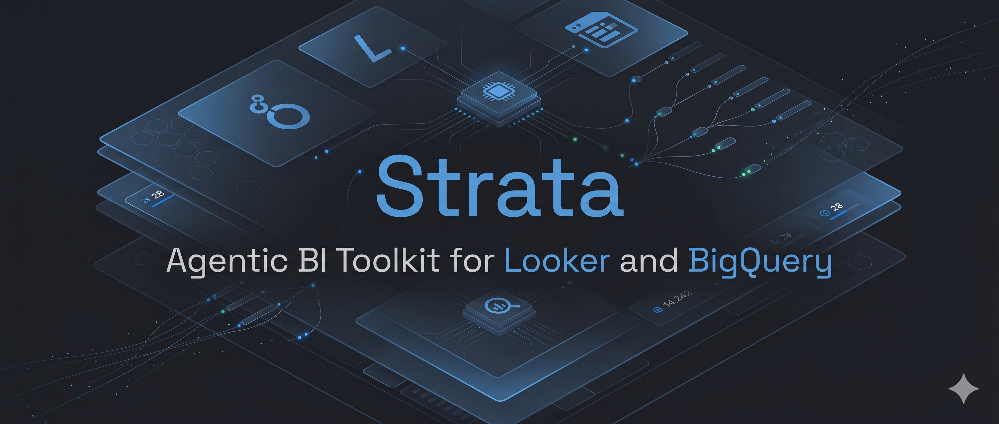
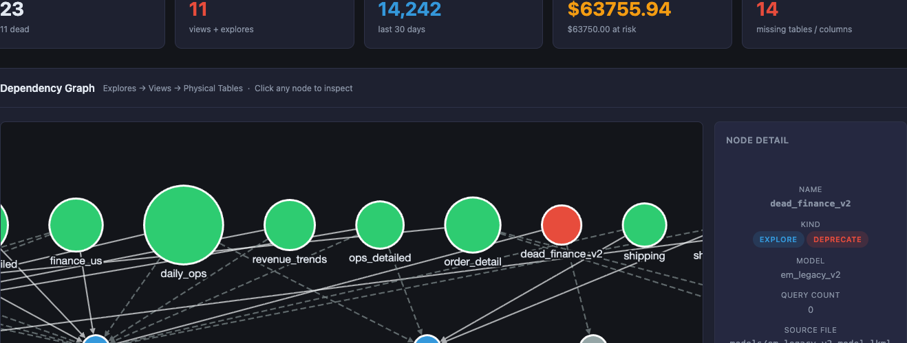
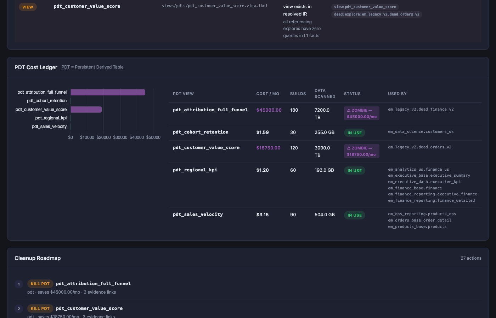
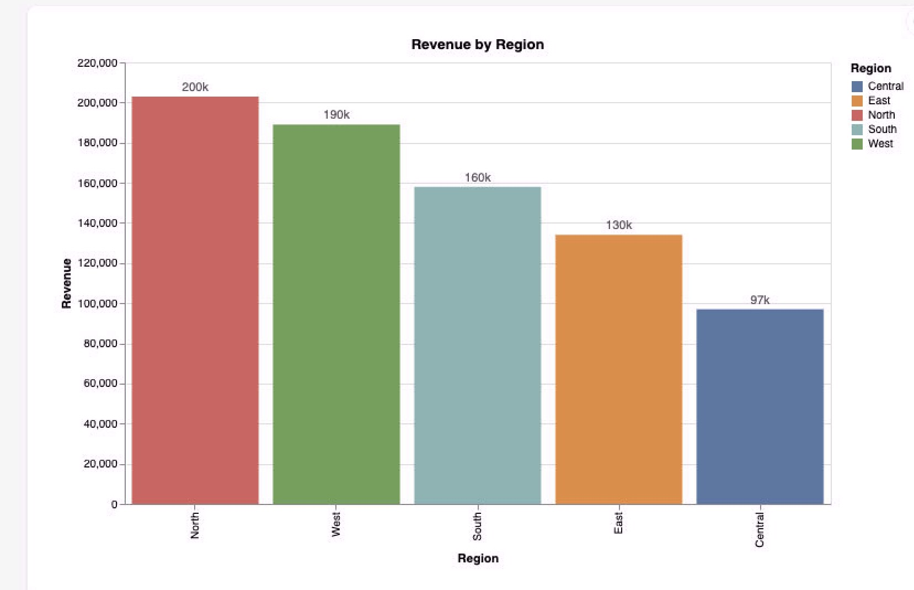
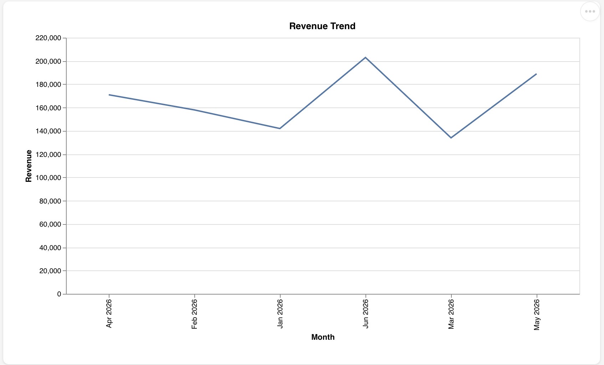
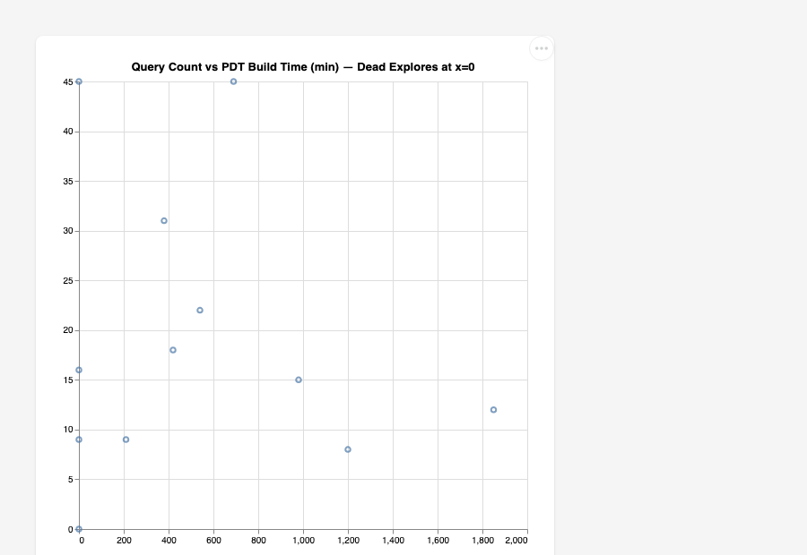
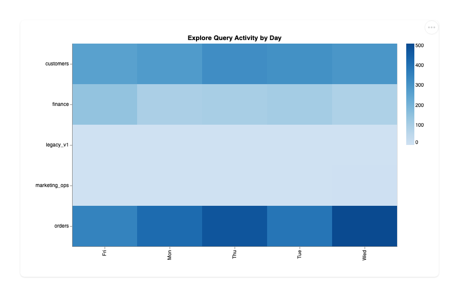

# Strata — Agentic BI Toolkit for Looker and BigQuery

<div align="center">
  
</div>

<div align="center">

[](https://pypi.org/project/strata-lookml/)
[](https://github.com/G-Schumacher44/strata-oss/actions/workflows/strata-ci.yml)
[](https://github.com/G-Schumacher44/strata-oss/blob/main/LICENSE)
[](https://www.python.org/)
[](https://modelcontextprotocol.io)
[](#quick-start)

</div>

If you're a BI engineer or analyst running Looker on BigQuery, your existing tools validate syntax
and catch broken SQL. They usually do not answer the governance questions that decide whether a
semantic-layer change is safe:

- Which explores had zero queries in the last 30 days?
- Which PDTs are rebuilding nightly at ~$45,000/month in estimated BQ compute to serve nobody? (illustrative: that figure is a hand-authored value in the bundled `enterprise_mono` demo fixture, not a measurement of any real warehouse)
- Which BigQuery column drops will silently break LookML before users find out at query time?

> **Naming, in short:**
> - The tool is **Strata**. The PyPI package is [`strata-lookml`](https://pypi.org/project/strata-lookml/) — the PyPI names `strata` and `strata-mcp` belong to unrelated projects.
> - The commands you type are unchanged: `strata`, `strata-mcp`, `strata-chart`.
> - The Python import package is `strata_lookml`. Through 0.1.8 it was `strata`, the same top-level name the unrelated `strata` and `strata-mcp` wheels ship, so installing either beside it overwrote files. Only code that does `import strata` needs updating; the commands are unaffected.
> - **Upgrading from 0.1.8 in an environment that also has the unrelated `strata` or `strata-mcp` package:** uninstalling 0.1.8 removes the `strata/` files they shared, so reinstall that package afterwards (`pip install --force-reinstall --no-deps strata`, or `strata-mcp`).
> - **`pipx` users:** the unrelated `strata-mcp` package also installs a command named `strata`. If it's on your machine, pipx will not link Strata's `strata` over it.
> - The `uvx` form below sidesteps this entirely — it runs in an ephemeral environment, so nothing collides.

## What Strata Is

Strata is a local **MCP** server and **CLI** toolkit. Point it at your **LookML** repo. Your AI client
gets **19 analysis tools** (18 read-only, 1 sandboxed chart renderer), **15 domain skills** with
structured investigation procedures, and a pre-built graph of your resolved LookML dependency
structure, enriched with BigQuery usage and schema facts. Offline-first: connecting to your Looker instance is preferred but optional; no credentials are required to start.

---

## Installation

```bash
# Run without installing (recommended). The CLI command is `strata`, which differs
# from the package name, so pass --from:
uvx --from strata-lookml strata --help

# Or install the CLI + MCP server persistently
pipx install strata-lookml
strata --help
```

`uvx strata-lookml` on its own starts the MCP server (the `strata-lookml` script is the same
entry point as `strata-mcp`).

Wire it into an MCP client — the server entry point is `strata-mcp`, resolved from the
`strata-lookml` distribution via `uvx --from strata-lookml strata-mcp`:

```json
{
  "mcpServers": {
    "strata": {
      "command": "uvx",
      "args": ["--from", "strata-lookml", "strata-mcp"],
      "env": { "STRATA_REPO_PATH": "/path/to/your/lookml" }
    }
  }
}
```

<p>
  <a href="cursor://anysphere.cursor-deeplink/mcp/install?name=strata&config=eyJjb21tYW5kIjoidXZ4IiwiYXJncyI6WyItLWZyb20iLCJzdHJhdGEtbG9va21sIiwic3RyYXRhLW1jcCJdLCJlbnYiOnsiU1RSQVRBX1JFUE9fUEFUSCI6Ii9wYXRoL3RvL3lvdXIvbG9va21sIn19">
    
  </a>
  <a href="vscode:mcp/install?%7B%22name%22%3A%22strata%22%2C%22command%22%3A%22uvx%22%2C%22args%22%3A%5B%22--from%22%2C%22strata-lookml%22%2C%22strata-mcp%22%5D%2C%22env%22%3A%7B%22STRATA_REPO_PATH%22%3A%22%2Fpath%2Fto%2Fyour%2Flookml%22%7D%7D">
    
  </a>
</p>

**Claude Code:**

```bash
claude mcp add strata -e STRATA_REPO_PATH=/path/to/your/lookml -- uvx --from strata-lookml strata-mcp
```

**Claude Desktop:** add the JSON block above to `claude_desktop_config.json`, or use the `.mcpb` bundle below.

Both badges embed the same `uvx --from strata-lookml strata-mcp` config above; edit
`STRATA_REPO_PATH` to your repo after installing. The badges are editor deep links that work
from GitHub; PyPI strips `cursor://` and `vscode:` links, so the JSON block above is the
portable path. A prebuilt `.mcpb` bundle for one-click
install in Claude Desktop is attached to each [GitHub Release](https://github.com/G-Schumacher44/strata-oss/releases).


## Quick Start

```bash
# Install the CLI + MCP server (or prefix each command with `uvx --from strata-lookml`)
pipx install strata-lookml

# Bootstrap your repo — creates conductor/, .mcp.json, and config.
# --yes runs without prompts (scripts, agents, CI); --dry-run prints the plan first.
# Writes are all-or-nothing: a failure leaves the repo as it was.
strata bootstrap --repo /path/to/your/lookml --yes \
  --bq-project my-project --usage-fixture usage_facts.json --schema-fixture schema_facts.json

# Cloned this repo to try the bundled playgrounds? Fetch their submodules first:
git submodule update --init --recursive
```

Without `--yes`, bootstrap prompts and needs a terminal (otherwise it exits 2 before writing
anything). `strata mcp config --client claude` prints the same `.mcp.json` bootstrap writes.

Wire your AI client (Claude Code, Cursor, Gemini). `.mcp.json` is written by bootstrap, or add it manually:

```json
{
  "mcpServers": {
    "strata": {
      "command": "strata-mcp",
      "env": { "STRATA_REPO_PATH": "/path/to/your/lookml" }
    }
  }
}
```

Verify everything is wired before opening your AI client:

```bash
STRATA_REPO_PATH=/path/to/your/lookml strata mcp validate
```

Live Looker enrichment is opt-in — start with offline fixtures, add `strata auth login` when ready.
See [Looker OAuth and Token Management](#looker-oauth-and-token-management).

**Your own LookML repo, no credentials.** Structural analysis needs only the `.lkml` files:

```bash
uvx --from strata-lookml strata query status  --repo /path/to/your/lookml   # parse + node counts
uvx --from strata-lookml strata query orphans --repo /path/to/your/lookml   # views no explore uses
uvx --from strata-lookml strata outputs       --repo /path/to/your/lookml --out strata-out   # JSON artifacts
```

Usage-based findings (zero-query explores, PDT cost) need usage facts: pass a fixture with
`--usage-fixture usage.json`, or run `strata auth login` and then
`strata outputs --repo /path/to/your/lookml --looker-url https://your.looker.instance` for live
enrichment. Logging in alone does not change what the `query` commands return.

<details>
<summary>Try it now with bundled playgrounds</summary>

Three LookML repos and matching fixture JSON ship in the repo (not in the PyPI package).
Clone it and install in editable mode — this is also the contributor setup — to run the full
analysis stack offline in under a minute:

```bash
git clone https://github.com/G-Schumacher44/strata-oss.git
cd strata-oss
pip install -e ".[dev]"
```

```bash
export STRATA_REPO_PATH=tests/lookml/enterprise_mono
export STRATA_USAGE_FIXTURE=tests/fixtures/enterprise_usage_facts.json
export STRATA_SCHEMA_FIXTURE=tests/fixtures/enterprise_schema_facts.json
```

```bash
$ strata check
Strata check passed (integrity 0, dead-code 11, unused-pdt 0, zombie-pdt 2, drift 14).

$ strata query status
{
  "node_counts": {"explore": 34, "view": 20, "field": 196, "pdt": 5},
  "edge_count": 378
}

$ strata outputs --out /tmp/strata-demo
{
  "catalog": "/tmp/strata-demo/catalog.json",
  "dead_code_register": "/tmp/strata-demo/dead_code_register.json",
  "pdt_ledger": "/tmp/strata-demo/pdt_ledger.json",
  "schema_drift": "/tmp/strata-demo/schema_drift.json",
  "usage_summary": "/tmp/strata-demo/usage_summary.json",
  "cleanup_roadmap": "/tmp/strata-demo/cleanup_roadmap.json",
  "migration_impact": "/tmp/strata-demo/migration_impact.json",
  "validation_scope": "/tmp/strata-demo/validation_scope.json"
}

$ strata mcp validate
  repo:       .../tests/lookml/enterprise_mono  (from STRATA_REPO_PATH env)
  ✓ repo path: exists
  ✓ LookML parse: 41 nodes (3 models, 9 views, 12 explores, 17 fields)
  ~ IR cache: not built yet
    The server builds it on start; `strata build` pre-warms it.
  ✓ skills: 15 found
  ✓ chart templates: 4 found
  ~ usage facts: STRATA_USAGE_FIXTURE not set
    usage-backed checks will report usage_checked=false.
  ~ BQ project: not set (gcloud default will be used)
    set bq_project in ~/.strata/config.json for 2-part table names
  ~ Looker token: missing
    Only needed for --looker-url; `strata auth login` creates it.

  MCP server is ready.
```

All three included playgrounds (`enterprise_mono`, `gcs_analytics`, `thelook`) have matching
usage and schema fixture JSON in `tests/fixtures/` — swap `--repo` and `--*-fixture` to run
against any of them. See [Fixture provenance](#fixture-provenance) for where each playground comes from.

</details>

<details>
<summary>Developer workflow</summary>

Strata utilizes **Ruff** for linting/formatting and **Mypy** for type checking.

**Linting and type checking:**

```bash
ruff check . && ruff format --check . && mypy src
```

Install pre-commit hooks to run checks automatically on every commit:

```bash
pre-commit install
```

Every PR is gated by:
- `ruff check src/ tests/ scripts/`
- `ruff format --check src/ tests/ scripts/`
- `mypy src/strata_lookml --ignore-missing-imports`
- `python -m pytest`

See [`.github/workflows/strata-ci.yml`](https://github.com/G-Schumacher44/strata-oss/blob/main/.github/workflows/strata-ci.yml) for details.

</details>

---

## LookML Governance

The flagship analysis. Runs fully offline from your LookML files and fixture JSON —
no Looker instance, no BQ credentials, no flaky API calls.

### Dead Code Campaigns

Strata builds a resolved dependency graph covering explores, views, joins, extends chains,
fields, PDTs, and physical tables. Cross-reference against 30 days of Looker System Activity
and content usage data, and you get exact dead code with dual evidence: the explore exists in
the resolved IR *and* has zero queries with no dashboard references. Dual evidence is designed to
eliminate false positives before you deprecate — see
[`docs/testing-findings.md`](https://github.com/G-Schumacher44/strata-oss/blob/main/docs/testing-findings.md) for the false-positive classes caught
and fixed during testing (CTE names misread as physical tables, zombie views invisible to the
orphan-only check).

From the `enterprise_mono` playground (a synthetic demo fixture; all dollar figures below are illustrative, not measurements):
- **6 dead explores** across 3 legacy connection clusters
- **5 zombie views** — referenced only by those dead explores
- **~$765,000/year** in compute serving no users

### PDT Cost Visibility

Surface which PDTs are building on schedule but backing dead explores. Cross-reference build
cost against query volume to identify zombie compute. Get the annualized number before you walk
into the conversation with the team.

```
pdt_attribution_full_funnel  →  ~$45,000/30d  →  dead_finance_v2 (0 queries)
pdt_customer_value_score     →  ~$18,750/30d  →  dead_orders_v2  (0 queries)
──────────────────────────────────────────────────────────────────
Zombie PDT cost:  ~$63,750/30d  (~$765,000/year)  [estimated; synthetic demo fixture]
```

> Costs are estimated from BigQuery scan volume (`bytes_processed` from Looker System Activity)
> at the standard on-demand rate ($5/TB). This is disk I/O — the data BQ reads from storage
> to build the PDT — not memory or output size. Flat-rate and committed-use customers will see
> different actual billing.

> The demo dollar figures above are hand-authored values baked into the `enterprise_mono`
> fixture (`tests/fixtures/enterprise_usage_facts.json`) for illustration — they are not
> computed by applying the $5/TB formula to that fixture. The formula itself is real and runs
> against live BigQuery scan bytes (`src/strata_lookml/l1/looker.py`) whenever `strata auth login` is
> used against a real Looker/BQ instance.

### Schema Drift Detection

LookML that references a column the warehouse dropped compiles fine in Looker — it fails
silently at query time. Strata catches these before your users do, with column-level traceability
from field definition back to the physical BQ table.

14 drift hits found across 3 tables in `enterprise_mono` — 9 from a real `int_inventory_risk`
schema migration that LookML was never updated to reflect.

### Safe Migrations and Blast Radius

Before dropping a BQ column or renaming a table, run impact analysis across the full LookML
graph. Every view, explore, and field that depends on it — with content reference counts.

### CI Gate

```bash
strata check --repo . --usage-fixture usage_facts.json --schema-fixture schema_facts.json
```

No Looker instance, no credentials, no flaky API calls. By default the gate fails only on
integrity: a missing repo or no `.lkml` files, an unresolved `extends` (missing target or
cycle), or a verdict that breaks the evidence contract. Dead code, unused and zombie PDTs, and
schema drift are counted and printed; add `--fail-on` to make any of them fail the build:

```bash
strata check --repo . --schema-fixture schema_facts.json --fail-on drift
strata check --repo . --usage-fixture usage_facts.json --schema-fixture schema_facts.json --fail-on all
```

Categories: `dead-code`, `unused-pdt`, `zombie-pdt`, `drift` (comma-separated), or `all` /
`none` (default). The usage categories need `--usage-fixture` and `drift` needs
`--schema-fixture`; asking for one without its fixture is a usage error, never a silent pass.
Exit codes: `0` passed, `1` gate failed, `2` usage error. `--json` prints
`{"passed", "failures": [{"category", "id", "message"}], "counts"}`; `counts` has every
category, `null` where its fixture was not loaded.

**Adopting on a legacy repo.** Record today's findings once, commit the file, and gate on new
ones only:

```bash
strata check --repo . --usage-fixture usage_facts.json --schema-fixture schema_facts.json \
  --write-baseline strata-baseline.json          # commit strata-baseline.json
strata check --repo . --usage-fixture usage_facts.json --schema-fixture schema_facts.json \
  --fail-on all --baseline strata-baseline.json  # fails only on findings not in the baseline
```

The baseline is JSON (`{"version": 1, "findings": {category: [sorted ids]}}`), sorted so it
diffs cleanly. Baselined ids are subtracted before `--fail-on` applies. Ids that no longer
exist are listed as stale (a warning, and `stale_baseline_ids` in `--json`; never a failure) so
you can regenerate and shrink the file. Integrity failures are never baselined. A missing or
unparseable baseline is a usage error (exit `2`). With `--baseline`, `--json` also reports
`baselined`, the number of findings it suppressed.

**What does my branch change?** In Looker dev mode your work is a git branch, and Strata
analyses whatever is checked out; usage evidence always comes from production. `strata diff`
compares two refs against the same fixtures and classifies every finding id as new, fixed or
unchanged:

```bash
strata diff main --usage-fixture usage_facts.json                  # main vs your working tree
strata diff origin/main my-branch --usage-fixture usage_facts.json --fail-on-new --json
```

`--fail-on-new` exits `1` if the head introduces any finding (a CI check for "does this PR add
dead code?"). `--json` prints `{"base": {"ref", "commit"}, "head": {...}, "new": [records],
"fixed": [records], "unchanged_count"}`. Refs are exported read-only with `git archive` into a
temp directory, so nothing is created in your repo; `git archive` leaves out submodule
contents. Every `strata check --json` and `strata build` also records the analysed
`source: {commit, branch, dirty}` when the repo is a git checkout.

<details>
<summary>How does Strata fit with existing tools?</summary>

| Tool | What it does | Where it stops |
|---|---|---|
| **LookML IDE / Extension** | Syntax validation, autocomplete, inline errors | Doesn't know query history, cost, or which explores are actually used |
| **Looker MCP Server** | Gives clients (Claude, Gemini, Codex, Cursor) live API access to Looker objects and system activity | A bridge for agents — surfaces data, doesn't analyze it |
| **Spectacles / content validation** | Runs explores in Looker to catch SQL compile errors | Reactive — tests what exists, doesn't surface what should be removed |
| **Looker native alerting** | Flags broken dashboards and scheduled query failures | Catches failures after they happen, not structural risk before it does |

Strata consumes what the Looker MCP Server surfaces (usage facts, system activity) and produces
what a Looker Extension could display (cost ledger, cleanup roadmap, drift report). The three
tools are complementary layers, not competitors.

</details>

---

### Dashboard

`strata workbench` (alias: `strata dashboard`) serves a local triage workbench at
`127.0.0.1:8765`: a page per finding and per explore, view, PDT, table and field, at stable URLs,
read from the same IR cache as the MCP server. It opens on **Findings**, the triage list: status
tabs (New, Acknowledged, Baselined, Fixed, Not checked, All) with counts, category chips, a text
filter and 200 rows per page, all plain links and query strings, so it works without JavaScript.
With JavaScript the list is keyboard-driven (`j`/`k` move, `Enter` open, `x` select, `/` filter,
`f` category, `1`–`6` tabs, `c` copy a PR comment, `y` copy `file:line`, `?` the full map).
Acknowledge from the terminal with `strata ack` for now; the web button arrives with the triage
POST. The other workbench pages are being built out slice by
slice; until they land, `strata dashboard --out DIR` keeps the static dashboard: all 8 output
artifacts plus a self-contained HTML observability panel, served from DIR. No JavaScript
framework, no CDN — all JS is bundled locally so it works in air-gapped or corp-network
environments.

The static dashboard has four panels:

- **Overview** — KPI tiles (active explores, dead artifacts, total PDT cost, schema drift hits) + the full dependency graph
- **Dead Code Register** — every flagged explore and view with dual-evidence badges (structural + usage). Click any node to see what backs it.
- **PDT Ledger** — cost per PDT per period, zombie vs. active status, which explores reference each PDT
- **Schema Drift** — missing columns/tables per view, mapped back to physical table and connection

```bash
strata dashboard \
  --repo tests/lookml/enterprise_mono \
  --usage-fixture tests/fixtures/enterprise_usage_facts.json \
  --schema-fixture tests/fixtures/enterprise_schema_facts.json \
  --out output/enterprise_mono
```


*enterprise_mono — 34 explores, 19 models, 30-day window. Green = active explore, red = dead explore, blue = view, orange = unused PDT, **purple = zombie PDT**, gray = physical table.*



*`dead_finance_v2` selected — rendered dead-red with a **deprecate** verdict and QUERY COUNT: 0 in the node detail. Its backing PDT, `pdt_attribution_full_funnel`, is the purple zombie diamond in the full graph above, rebuilding at ~$45,000/month (estimated fixture data) to serve it.*



*PDT Cost Ledger — both zombie PDTs flagged ⚠ with their monthly cost and the dead explores that consume them, above the Cleanup Roadmap's KILL actions. Every verdict carries evidence links; the Dead Code Register panel (visible at top) applies the same dual-evidence rule — structural and usage tags both required before anything is flagged.*

<details>
<summary>How it works — L0 → L1 → L2 pipeline</summary>

```
LookML repo (read-only clone)
        │
        ▼
   L0 — IR Builder
        Parse all .lkml files → canonical node/edge graph
        Resolve extends chains, refinements, cross-model dependencies
        No LLM. No network. Pure deterministic Python.
        │
        ▼
   L1 — Enrichment
        Join IR against usage facts (explore queries, PDT builds)
        Join IR against schema facts (warehouse column inventory)
        Produces: dead code evidence, PDT cost ledger, schema drift records
        Offline: fixture JSON  |  Live: Looker OAuth → System Activity API
        │
        ▼
   L2 — Synthesis
        One explore = one verdict with evidence
        Lightweight model, clean structured context
        Outputs: cleanup roadmap, migration impact, validation scope
        │
        ├── JSON artifacts   catalog / dead code / PDT ledger / drift / impact
        ├── HTML dashboard   strata dashboard
        ├── MCP server       19 tools (18 read-only + 1 sandboxed render), stdio, any MCP client
        └── CLI              strata check / outputs / build / validate
```

L0 never calls any LLM or external API — pure offline deterministic Python. L1 enrichment
is offline by default (fixture JSON); live Looker System Activity API access is opt-in via
`strata auth login`. The MCP server transport is stdio-only — it opens no port and has no cloud
dependency (`strata workbench` / `strata dashboard` is the one command that runs a local web server, on `127.0.0.1`).
Strata never modifies `.lkml` files; the local files it does write are listed in
[Security Hardening](https://github.com/G-Schumacher44/strata-oss/blob/main/docs/security-hardening.md#what-strata-reads-and-writes).

</details>

<details>
<summary>Philosophy — why deterministic first?</summary>

Parsing LookML, resolving extends chains, detecting dead code, computing PDT cost — these are
deterministic problems. They cost zero tokens. The structure doesn't need an LLM to understand
it; it needs to be mapped.

Strata maps it first. Then a lightweight model reasons over a clean, structured context. This gets
more capable as models improve and more efficient over time. The deterministic layer never changes.

LookML's declarative model — explicit `explore:`, `join:`, `view:`, `extends:` — makes this
possible. Every dependency is named and resolvable without executing a query. Most BI tools
don't have this. A dbt project has a DAG but no semantic layer. A Tableau workbook has implicit
dependencies that are hard to traverse programmatically. LookML's structure is what makes
"what breaks if I change this?" answerable with certainty, not heuristics.

</details>

---

## MCP, Skills, and Agent Workflow

### The MCP Layer

19 tools over stdio — 18 read-only, plus `strata_render_chart`, which writes only to
`~/.strata/output` or `/tmp` (sandboxed, never your LookML repo). Works with any MCP client.
All tools run against the local IR cache — no live Looker connection required. The cache lives
at `~/.strata/cache/<repo-name>-<hash>.db` (override: `STRATA_CACHE_PATH`), never in your repo,
and is reused only when the server starts with the same repo and fixtures. For live usage
enrichment, see [Looker OAuth](#looker-oauth-and-token-management) below.

```
Agent calls: strata_dead_code_register
  → 6 dead explores, 2 zombie PDTs, ~$63,750/mo estimated in unused compute (synthetic demo fixture)

Agent calls: strata_explore_deps("dead_finance_v2", "em_legacy_v2")
  → full join graph: 4 views, 1 zombie PDT backing this explore

Agent calls: strata_schema_drift
  → 14 drift hits across 3 tables — column drops not reflected in LookML

Agent calls: strata_validation_scope(["views/orders.view.lkml"])
  → 3 explores affected — minimum revalidation set for this PR
```

<details>
<summary>All 19 tools</summary>

| Tool | Returns |
|---|---|
| `strata_ir_status` | Graph summary: node counts, model list, resolution errors |
| `strata_dead_code_register` | Dead explores + zombie views with dual evidence |
| `strata_pdt_costs` | PDT ledger: cost/mo, build count, bytes, status |
| `strata_schema_drift` | Column-level drift: field exists in LookML, missing in warehouse |
| `strata_explore_deps` | Full join graph for an explore |
| `strata_query_field` | Field definition: type, SQL, tags, usage |
| `strata_list_orphans` | Orphaned views (`kind` is `all` or `view`; explore/field orphans are not detected) |
| `strata_usage_summary` | Query counts, top explores, usage gaps |
| `strata_validation_scope` | Impact set for a set of changed .lkml files |
| `strata_impact` | Views, explores, and fields affected by a physical table change |
| `strata_object` | One object (explore, view, PDT, table, field): lineage, findings, coverage, content usage |
| `strata_find_field` | Search fields by name, SQL, label, description, or tag |
| `strata_view_sources` | All views with backing BQ table, field count, orphan flag |
| `strata_navigate` | One-call ticket brief: views/explores/fields for an anchor, cited as file:line |
| `strata_list_skills` | Compact metadata for all bundled skills |
| `strata_skill` | Full skill content — loaded only when requested |
| `strata_render_chart` | Vega-Lite spec + data → self-contained HTML |
| `strata_chart_templates` | Available chart types |
| `strata_conductor_status` | Active workflow slice and next steps |

</details>

### LLM Cost Controls

L0 and L1 analysis costs zero tokens — pure deterministic Python, no model calls. Tool responses
return structured JSON, not prose, so each MCP call adds ~200–500 tokens to context rather than
paragraphs of explanation. Skills are lazy-loaded: `strata_skill("name")` pulls one skill on
demand; the rest cost nothing. L2 synthesis does use tokens, but against clean structured
context. Composite tools keep round-trips low: `strata_navigate` returns a full ticket brief
(views, explores, fields, `file:line` citations) in **one call** instead of an agent hand-
orchestrating several separate lookup primitives — a single structured payload in place of
stitching those calls together, and far fewer context-carrying round-trips.

For long-running investigations, Conductor's slice-based handoffs let an agent resume from a
single targeted file load (index + handoff-log) rather than re-deriving state from scratch —
keeping per-session context lean without measuring token counts explicitly.

### Looker OAuth and Token Management

All 19 tools (18 read-only, 1 sandboxed chart renderer) work fully offline against the local
IR cache. Live Looker enrichment is opt-in:

```bash
strata auth login --looker-url https://your-instance.looker.com
strata auth status
```

`strata auth login` runs the OAuth authorization-code flow with PKCE (S256) and a verified
`state`, capturing the redirect on a one-shot `127.0.0.1` listener (default redirect URI
`http://127.0.0.1:48765/oauth/callback`, which a Looker admin registers on the OAuth client app;
`--no-browser` reads the pasted redirect URL from stdin instead). Implemented from Looker's
[OAuth guide](https://docs.cloud.google.com/looker/docs/api-cors); **not yet validated against a
live Looker instance.**

The access token is stored at `~/.strata/tokens.json`: file 0600, directory 0700 (POSIX; a custom
`--token-path` must already be in a private directory). It is
refused on read if group/world accessible, checked for expiry before each request, and sent only
to the Looker origin that issued it. Looker URLs must be `https://` (`http://` is accepted only
for `localhost`/`127.0.0.1`), and requests do not follow redirects. The MCP tools never read the
token. `strata auth logout` deletes the local copy only — revocation is done by a Looker admin.
Full model: [`docs/security-hardening.md`](https://github.com/G-Schumacher44/strata-oss/blob/main/docs/security-hardening.md).

For enterprise: identity and access, OIDC for GitHub Actions, and Google Workspace IAM path in
[`docs/enterprise-deployment.md`](https://github.com/G-Schumacher44/strata-oss/blob/main/docs/enterprise-deployment.md).

### Skills — Structured Investigation Procedures

15 domain skills bundled with the package. Zero tokens until an agent calls `strata_skill("name")`.
Each skill defines trigger conditions, allowed tools, a step-by-step procedure, stop conditions,
output format, and escalation scripts. `lookml_ticket_navigator` is the day-to-day ticket entry
point: give it a BQ table, field, view, explore, or `.lkml` file and it returns the source-cited
brief an agent needs before editing.

Designed to run with smaller, task-appropriate models — `[JUDGMENT]` marks the few steps that require reasoning;
everything else is mechanical. A typical BigQuery investigation chains skills like this:

```
Agent reads skill: bq_schema_probe
  → procedure: which BQ datasets to check, how to validate grain, stop conditions
  → agent queries information_schema to map physical tables to LookML views

Agent reads skill: grain_validator
  → detects fan-out risk in joins, missing relationship: declarations

Agent reads skill: sql_builder
  → structured SQL construction for BQ with cost guardrails applied first

Agent reads skill: sql_optimizer
  → optimization rules flagged against the built query

Agent reads skill: bq_query_guardrail
  → final cost and safety gate before any query executes
```

<details>
<summary>All 15 skills</summary>

| Domain | Skills | Use when |
|---|---|---|
| BigQuery | `bq_schema_probe`, `grain_validator`, `sql_builder`, `sql_optimizer`, `bq_query_guardrail` | Inspect warehouse schema, draft SQL, validate grain, and keep queries cost-safe |
| LookML | `lookml_ticket_navigator`, `lookml_view_reviewer`, `lookml_explore_join_reviewer` | Find what to touch, review fields/views, and verify explore joins |
| Looker | `semantic_layer_audit` | Audit semantic-layer health across usage, drift, and dependency evidence |
| Delivery | `jira_to_bi_spec`, `bi_incident_responder`, `release_notes_generator` | Turn tickets/incidents/merged changes into scoped BI artifacts |
| Visualization | `chart_composer`, `dashboard_composer` | Compose charts and dashboards from governed fields and evidence |
| Governance | `conductor_manager` | Manage Conductor slices, phases, and handoffs |

</details>

### Conductor — Agent Workflow Management

Conductor is the session continuity system for agent work. It tracks active slices (bounded
work units), acceptance criteria, and handoff state across sessions — so an agent picking up
where another left off has full context without re-deriving it.

**Deploy Conductor into your repo:**
```bash
strata bootstrap --repo /path/to/your/lookml
# Creates: conductor/index.md, conductor/handoff-log.md, .mcp.json
```

**During an investigation:**
```bash
strata conductor new-slice "Audit dead explores in gcs_analytics"
strata conductor status
strata conductor log-handoff --completed "dead code register" --next "PDT cost review"
```

The handoff log records commit hash, what was completed, and exact next steps. `strata validate`
checks the log format and verifies the referenced commit exists in git — catching hallucinated
handoffs before they compound.

For the full investigation workflow — gate verification, findings format, stop conditions,
live enrichment options — see the **[Governance Runbook](https://github.com/G-Schumacher44/strata-oss/blob/main/docs/runbook.md)**.

### Vega-Lite Charts — Built In

```bash
strata chart bar data.json --title "Revenue by Region" --open
strata chart line trend.json --open
strata chart scatter correlation.csv --open
strata chart heatmap activity.json --open
```

Each template expects default column names (`strata chart line --help` lists them, read from the
template). If your data uses other names, map them with `--x`, `--y` and `--color` instead of
renaming columns:

```bash
strata chart line sales.json --x month --y revenue --color region
```

A chart whose encoding names a column that is not in the data fails with the missing and the
available columns, instead of rendering a blank chart. The same check applies to
`strata_render_chart` and `strata query navigate --chart`. The check covers single-view charts; layered, composite and transform specs are
passed to Vega unchecked.

<table>
<tr>
<td align="center"><br/><sub><b>bar</b> — categorical comparison</sub></td>
<td align="center"><br/><sub><b>line</b> — trend over time</sub></td>
</tr>
<tr>
<td align="center"><br/><sub><b>scatter</b> — correlation</sub></td>
<td align="center"><br/><sub><b>heatmap</b> — two-dimensional breakdown</sub></td>
</tr>
</table>

4 chart types. JS bundled locally — charts are self-contained HTML files that render offline.
Built on [Vega-Lite](https://vega.github.io/vega-lite/) by the [UW Interactive Data Lab](https://idl.cs.washington.edu/) ([@uwdata](https://github.com/vega)).

---

## CLI

18 commands. Full reference: [`docs/cli-guide.md`](https://github.com/G-Schumacher44/strata-oss/blob/main/docs/cli-guide.md).

| Command | What it does |
|---|---|
| `strata ack` | Acknowledge findings by id (stored in `~/.strata/triage/`, never in the repo) |
| `strata auth` | Authenticate with Looker and manage local OAuth tokens |
| `strata bootstrap` | Scaffold Strata into a repo — conductor/, .mcp.json, config |
| `strata build` | Parse LookML and write the IR cache (`~/.strata/cache/`) |
| `strata chart` | Render charts to self-contained HTML |
| `strata check` | Offline governance gates — dead code, drift, PDT, verdict validation |
| `strata clean` | Remove `output/`, the repo's IR cache entry, legacy in-repo `strata_ir.db`, `__pycache__` |
| `strata conductor` | Manage slice-based agent workflow and handoffs |
| `strata diff` | Findings a branch introduces or fixes, against production usage |
| `strata dashboard` | Alias of `strata workbench`; `--out DIR` writes and serves the static HTML dashboard |
| `strata findings` | List findings with triage status — table, `file:line:` lines for fzf/vim, or JSON |
| `strata generate-schema` | Pull BigQuery INFORMATION_SCHEMA facts for drift checks |
| `strata mcp` | Run, validate, and inspect MCP server configuration |
| `strata outputs` | Write 8 JSON artifacts to an output directory |
| `strata query` | Inspect the IR from the terminal |
| `strata skill` | List bundled skills or print a skill procedure |
| `strata unack` | Withdraw acknowledgements by id |
| `strata validate` | Conductor spine check — handoff format, active slice, replay facts |
| `strata workbench` | Serve the local triage workbench (findings, overview, a page per object) |

### Triage from the terminal

`strata findings` lists what `strata check` would report, with a triage status (`new` by default;
`--status acknowledged|baselined|fixed|not_checked|all`, `--category`, `--baseline FILE`).
`--format lines` prints one finding per line, `file:line: [category] label — message (id)`;
a finding with no file prints `-:0:`. With a workbench base (`--workbench-url`, `STRATA_WORKBENCH_URL` or config) each row also gets its finding URL (` <url>` after the id in `lines`, a `url` key in `json`). Paths are relative to the repo root, so run these from it.
Acknowledgements live in `~/.strata/triage/`, never in the repo, and never change `strata check`.

```bash
# fzf: pick findings, acknowledge them (the id is the trailing "(...)")
strata findings --format lines | fzf -m | sed -E 's/.* \((.*)\)( <[^>]*>)?$/\1/' | strata ack - --note "known"

# vim quickfix: the lines match vim's default errorformat (%f:%l:%m)
vim -q <(strata findings --format lines)

strata ack <id>...      # `-` reads ids from stdin, one per line
strata unack <id>...
```

### Error handling

Exit codes: `0` success, `1` failure (not found, invalid input, missing repo or no `.lkml`
files, failed gate), `2` usage error (unknown option, missing argument). Errors go to stderr as
`Error: <message>` with a `Hint: <next step>` line when there is one. Commands that print JSON
(`strata query ...`, `strata build --json`, `strata auth status`) also print the error to stdout
as JSON, so scripts can branch on `code`:

```json
{"error": "field not found: orders.nope", "code": "not_found", "hint": "Search field names with strata_find_field (CLI: strata query find-field)."}
```

`code` is `not_found` or `invalid_input`; `hint` may be `null`. Over MCP the same failures come
back as tool errors (`isError: true`) with the message and hint as text.

---

## CI and Bot Deployment

Strata ships two decoupled CI workflows: a **hard gate** that blocks the build on
test failures, and a **soft gate** that posts advisory PR review without breaking it.

<details>
<summary>1. PR Comment Bot (soft gate)</summary>

`strata-pr.yml` runs on **every PR** and posts a single, self-updating comment with
impact analysis — which explores break, validation scope, blast radius — plus the
Conductor spine check (`strata validate`). The comment is upserted in place on each
push (no duplicate comments), and a failing `strata validate` is surfaced in the
comment **without** failing the build, so quick human fixes aren't blocked.

```yaml
# .github/workflows/strata-pr.yml  (included in repo)
on:
  pull_request:
```

See [`.github/workflows/strata-pr.yml`](https://github.com/G-Schumacher44/strata-oss/blob/main/.github/workflows/strata-pr.yml) and
[`scripts/pr_comment.py`](https://github.com/G-Schumacher44/strata-oss/blob/main/scripts/pr_comment.py) for the full workflow.

</details>

<details>
<summary>2. CI Test Pipeline (hard gate)</summary>

`strata-ci.yml` runs lint (`ruff`), types (`mypy`), the test suite (`pytest`), and
offline `strata check` / `strata outputs` across the bundled playgrounds. `strata check` gates
integrity; the playground scenarios (each still shows its dead code, PDT and drift findings)
are pytest cases in `tests/test_scenarios.py`.

```yaml
# .github/workflows/strata-ci.yml
- name: Strata offline analysis
  run: |
    strata check \
      --repo . \
      --usage-fixture usage_facts.json \
      --schema-fixture schema_facts.json \
      --fail-on drift
```

Exits 0 if the gate passes, 1 if it fails. No Looker instance, no credentials, no flaky API calls.

</details>

### Output Artifacts

`strata outputs` writes 8 JSON files per run: `catalog`, `usage_summary`, `dead_code_register`,
`pdt_ledger`, `schema_drift`, `migration_impact`, `cleanup_roadmap`, `validation_scope`. All
deterministic — same fixtures produce identical output. Feed them to downstream reporting or
consume them in your AI client via the MCP layer.

---

## How We Validated

Three offline playgrounds, all findings sourced from actual output artifacts.
Full breakdown: [`docs/testing.md`](https://github.com/G-Schumacher44/strata-oss/blob/main/docs/testing.md).

<details>
<summary>Playground findings — enterprise_mono · gcs_analytics · thelook</summary>

**enterprise_mono** — synthetic demo fixture authored for Strata (dollar figures below are illustrative). 19 models, 34 explores, cross-model extends, 3 legacy connection clusters:

- 6 dead explores (0 queries over 30 days) — all flagged with dual evidence
- 5 zombie views — referenced only by dead explores
- 2 zombie PDTs rebuilding at ~$63,750/month estimated — backed exclusively by dead explores
- **~$765,000/year** in compute serving no users
- 14 schema drift hits across 3 tables (9 from a real `int_inventory_risk` migration)

**gcs_analytics** — synthetic fixture authored for Strata (dollar figure illustrative); gold/silver BQ layer, mixed active and legacy:

- 6 dead items (2 orphan views, 2 zombie views, 2 dead explores)
- 1 unused PDT (~$156/month estimated, no explore backer)
- 1 schema drift hit

**thelook** — structural baseline built from a fork of Google's public, archived `looker-open-source/thelook` demo repo (see [Fixture provenance](#fixture-provenance)):

- 6 dead items (1 orphan view, 1 zombie view, 4 dead explores)
- 1 schema drift hit

Each playground ships with matching fixture JSON files (`tests/fixtures/`) that simulate
Looker System Activity API responses — so the full analysis runs offline with no credentials.

### Fixture provenance

- `thelook` is a git submodule pointing at a fork of Google's public, archived
  [`looker-open-source/thelook`](https://github.com/looker-open-source/thelook) demo repo
  (which carries no license file), extended with Strata playground files. It is used only as a
  test fixture and is not redistributed in the PyPI package (the sdist and wheel include only
  `src/`, `README.md`, `LICENSE`, `THIRD_PARTY_LICENSES` and `pyproject.toml`). No license to its
  upstream contents is claimed.
- `gcs_analytics` and `enterprise_mono` are synthetic fixtures authored for Strata.

</details>

---

## Docs

Full index: [**docs/README.md**](https://github.com/G-Schumacher44/strata-oss/blob/main/docs/README.md)

<details>
<summary>Quick links</summary>

| | |
|---|---|
| [`docs/runbook.md`](https://github.com/G-Schumacher44/strata-oss/blob/main/docs/runbook.md) | Governance investigation playbook — gate, workflow patterns, findings format |
| [`docs/cli-guide.md`](https://github.com/G-Schumacher44/strata-oss/blob/main/docs/cli-guide.md) | Full CLI reference — all commands, env vars, output artifacts |
| [`docs/testing.md`](https://github.com/G-Schumacher44/strata-oss/blob/main/docs/testing.md) | Playgrounds, scenarios, how to run them |
| [`docs/testing-findings.md`](https://github.com/G-Schumacher44/strata-oss/blob/main/docs/testing-findings.md) | Full findings — real numbers, drift breakdowns, agentic benchmarks |
| [`docs/security-hardening.md`](https://github.com/G-Schumacher44/strata-oss/blob/main/docs/security-hardening.md) | What Strata reads and writes, OAuth + token handling, query construction, MCP security model |
| [`docs/enterprise-deployment.md`](https://github.com/G-Schumacher44/strata-oss/blob/main/docs/enterprise-deployment.md) | IAM, OIDC for GH Actions, Google Workspace path |
| [`docs/CONTRIBUTING.md`](https://github.com/G-Schumacher44/strata-oss/blob/main/docs/CONTRIBUTING.md) | Contribution guide |

</details>

---

## License

[Apache 2.0](https://github.com/G-Schumacher44/strata-oss/blob/main/LICENSE) — © 2026 Garrett Schumacher

Third-party JavaScript libraries vendored for offline report rendering are listed, with their licenses, in [`THIRD_PARTY_LICENSES`](https://github.com/G-Schumacher44/strata-oss/blob/main/THIRD_PARTY_LICENSES).

Strata is an independent open-source project and is not affiliated with, endorsed by, or sponsored by Google, Looker, Anthropic, Cursor, Microsoft, or the Model Context Protocol project. Looker, LookML, BigQuery, Claude, Cursor, VS Code and other names are trademarks of their respective owners and are used here only to describe compatibility.

Portions of this codebase were developed with AI coding assistants under the author's direction and review.

<!-- mcp-name: io.github.G-Schumacher44/strata-oss -->
